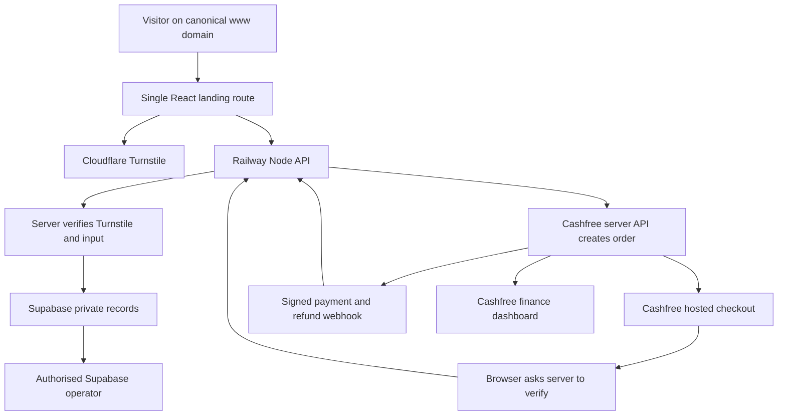

# Project audit and release plan

**Follow-up:** The owner's field media is now supplied. The subsequent published-Lovable presentation restoration and the effect of October/November commits are recorded in [docs/REFERENCE_RESTORATION.md](docs/REFERENCE_RESTORATION.md). The findings below describe the original Cashfree audit baseline, not the restored presentation.

Audit dates: 15-16 November 2026. Baseline: main `9cd24bc`. Scope: repository inventory, public application/server/data/deployment flows, current public website and the supplied Lovable reference. This is a code and workflow review, not a medical-content certification or a claim that unconfigured provider accounts were tested.

## Current stage

The informational website is publicly hosted and the custom domain is working. At the start of this audit the live site showed online assistance and donations disabled, used the old phone number and Razorpay copy, and had no field media. The owner reports that Supabase and Cloudflare have been created but Railway variables have not yet been added. Their private account configuration and database contents were not inspected.

This release implements the Cashfree migration and closes the identified code/documentation gaps. **Operational activation still requires SQL verification, real credentials, provider/domain setup, acceptance tests, approved media and assigned staff.** A public website is not yet a validated donation/assistance operation.

## Architecture and trust boundaries

| Area | Implementation and assessment |
| --- | --- |
| UI/routing | React 19, TanStack Start/Router, single index landing route; accordion sections, drawer, policies and 404/error handling |
| Build/runtime | Vite 8, Nitro Node output, multi-stage Dockerfile, non-root runtime, Railway PORT, `/api/health` liveness |
| Shared rules | Zod browser-safe form schemas, Indian phone validation/normalisation, INR amounts |
| Assistance | Same-origin JSON API, bounded request body, consent, honeypot, Turnstile hostname/action verification, short-lived exact-payload permit, database validation and phone-based limits |
| Privacy | Public role can only insert allowed assistance fields with a valid permit; no public reads/updates/deletes; donations and permits private; staff fields cannot be submitted by visitors |
| Donations | Cashfree REST API credentials remain server-side; UUID token ownership; deterministic order saved before gateway request; idempotency key reused; hosted SDK receives only payment session |
| Verification | Provider order, currency and amount checked; successful captured payment required; browser claims ignored; HMAC signature uses raw webhook bytes and timestamp; database updates are monotonic and idempotent |
| Refunds | Successful refund records fetched from provider and deduplicated; pending refunds do not reduce income; old events cannot undo refunds; no automatic refund creation |
| Operations | Supabase Table Editor and Cashfree dashboard; private assignment/follow-up/settlement/receipt fields; no custom staff web login or outbound notification service |
| Assets | NGO logo is local; gallery is an explicit manifest supporting image/video/poster/captions/transcript; no field files supplied yet |
| Documents | Health guide generated in browser; reports/proposals requested by email; branded donation receipt generated on the server after provider verification |
| CI | Typecheck, tests, advisory scan, production build/smoke and added Linux Docker build; main must be gated with Railway Wait for CI |

The complete repository inventory is in [docs/CODEBASE_INVENTORY.md](docs/CODEBASE_INVENTORY.md). Domain-specific runtime, schema and deployment paths were traced in detail. Generic unused shadcn components were inventoried/static-scanned, not individually exercised as product features. Generated output, local credentials and dependency source are not project-owned feature code.

## Public site comparison

Both sites were opened in a browser during this audit. `thehouseofdoctor.in` redirected to `www.thehouseofdoctor.in`; the Lovable reference remained at its supplied URL.

| Feature | Lovable reference observed | Railway baseline / release decision |
| --- | --- | --- |
| Identity, services, contact | Doctor-led NGO, Udaipur, rural/tribal services, old phone | Retained current branding; updated every active contact, tel/WhatsApp, PDF and structured-data number |
| Navigation | Home/About/Services/Gallery/Help Desk anchors | Current accordion design retained; added Focus Areas and Health Library links; legacy `#helpdesk` resolves to current help desk |
| Patient support | Explicit support service and form option | The Help Desk includes Patient support and Other. Mewar Connect handles partnership and volunteering enquiries. |
| Gallery | Six labelled placeholder frames and instruction to add photos | No real missing photos could be recovered; prepared image/video playback and truthful empty state, awaiting supplied files |
| Donation | Card number, expiry and CVV fields displayed on the site; no real transaction tested | Kept sensitive payment fields at provider; replaced Razorpay with Cashfree hosted checkout and server verification |
| Donation amounts | Several different presets | Retained repository's specified INR 500 / 1000 / 5000 + custom; custom supports other amounts |
| Help desk | Chat with Support and a 24-hour response statement | Explicit WhatsApp link and clear unmonitored-form warning retained; staffing promise not invented |
| Legal/social footer | Policy/accessibility/social links pointed to `#` | Real policy sections retained; unverified social destinations not fabricated |
| Additional current features | No equivalent visible for current expanded sections | Mewar Connect, focus areas, education search and publications retained |

The legacy site should not continue collecting enquiries or displaying old contact/payment information after cutover. Publishing/unpublishing it is a separate owner action; this release updates the requested GitHub main branch, not an unrelated Lovable publication.

## Gaps resolved in this release

1. Replaced Razorpay API/SDK/signature flow with Cashfree. Added explicit sandbox/production environment matching and safe payment pause behaviour.
2. Saved deterministic order identity before network calls; authenticated recovery retries the same order after a creation timeout. Never creates a new order during a status check.
3. Handles successful/failed/dropped payment and refund events by rechecking provider state. Handles order-linked auto-refund events; unknown/no-order events cannot mark a donation paid.
4. Preserves legacy Razorpay rows and blocks them from being mistaken for Cashfree payments. No records are deleted by the schema update.
5. Updated phone to +91 75689 68704 throughout runtime copy, call links, WhatsApp, metadata and PDFs.
6. Added staff assignment/follow-up and finance reconciliation fields, plus read-only operations queries and a channel-by-channel operating procedure.
7. Added patient-support/other request categories, health-library/focus navigation, scrollable mobile menu and old helpdesk anchor compatibility.
8. Added video/poster/caption/transcript support; photos remain accessible and respect pause/reduced motion.
9. Corrected production canonical fallback/social image metadata and replaced obsolete branch/provider setup instructions with the actual www deployment and exact variables.
10. Added manual CI triggering, concurrency control, job timeout and Docker image validation to match Railway deployment more closely.

## Button and channel audit

| Control | Behaviour / evidence |
| --- | --- |
| Header Donate / Support Our Mission / drawer Donate | Navigates to donation section; disabled checkout communicates missing configuration |
| Request Assistance / Help Desk | Opens and scrolls to assistance accordion; observed in live baseline and local updated browser |
| Drawer and footer section buttons | Controlled accordion opening; Health Library navigation checked at mobile width; dialog closes correctly |
| Donation presets / Custom | State selection with INR amount; custom numeric validation; no payment can start without configured provider/verification/consent |
| Check status / Resume / Retry this order | Authenticated server verification and same-order recovery; tested with mocked gateway responses and browser component tests |
| Download donation receipt | Authenticates the donor session and rechecks payment/refunds before generating the branded PDF |
| Clear checkout | Requires a clear warning about debits/uncertain results; cannot cancel a provider payment |
| Call / WhatsApp / email / map | Correct new phone and established email/location links inspected; no calls/messages were sent |
| Partnership / report request | Opens an email draft with subject; requires visitor to send and NGO office to monitor mailbox |
| Library search | Filters locally; baseline search for diabetes checked in browser |
| Health guide | Publication section/email links verified; guide download observation timed out; download acceptance remains in checklist |
| Policies | Anchor reveals the corresponding details panel; refund link checked in updated browser |
| Gallery controls/video | Implemented and component-tested; real media playback awaits supplied files |

## Remaining launch dependencies and risks

| Priority | Item | Owner / next action |
| --- | --- | --- |
| Launch gate | Existing Supabase may not yet have current schema | Owner: export/verify any records, apply production.sql, run verify-setup.sql to PASS |
| Launch gate | Railway secrets absent; actual remote services untested | Owner: FIRST_TIME_SETUP variable template; submit labelled QA request and verify row |
| Launch gate | Cashfree merchant approval/credentials/domain/webhooks | Owner + finance: sandbox checklist, then approved live payment and settlement reconciliation |
| Launch gate | Staff coverage / mailbox monitoring | NGO manager: assign coordinator/backup, finance and office owners; use OPERATIONS |
| Content pending | Field photos/videos and official reports | Owner: supply approved files/captions; MEDIA_GUIDE describes publication |
| Content approval | Inherited registered-NGO, hospital, 24x7 ambulance and health guidance claims | NGO leadership/clinician: confirm factual availability and approve wording; code audit is not independent verification |
| Staff operations update | The private staff workspace shows requests and donation records | Staff monitor the queue during their rota. Cashfree remains the reconciliation source. |
| Operational limitation | No automated bank settlement, dispute or tax-certificate workflow | Finance dashboard and bank reconciliation, private ledger notes; no fabricated settled/80G status |
| Reliability | Healthcheck checks process only, not services; webhook retry window is finite | Monitor provider logs and unresolved rows; replay failed events and investigate exceptions |
| Release controls | Railway Wait for CI and actual live variables not inspected | Owner checks dashboard; code contains CI but cannot enable Railway settings by itself |

## Release sequence

Code verification and normal push to main -> GitHub Actions -> Railway deploy -> SQL and variables -> assistance acceptance -> Cashfree sandbox -> staffed operations/media approval -> owner-approved live donation -> settlement/receipt reconciliation.

See [VALIDATION.md](VALIDATION.md) for dated results and outstanding external acceptance. No patient/donor rows, provider credentials or real payments were accessed during this audit.
